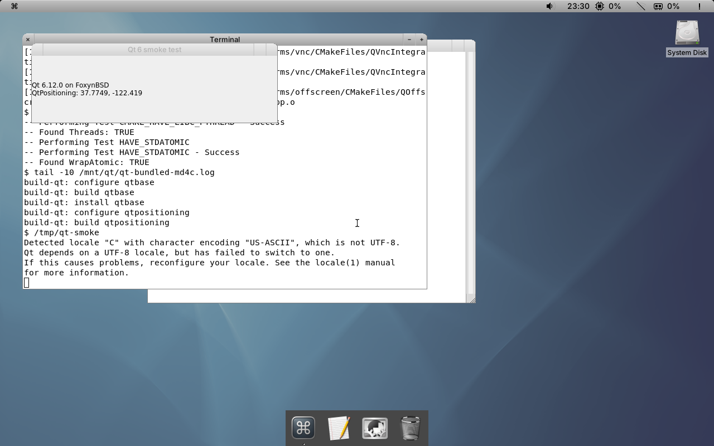
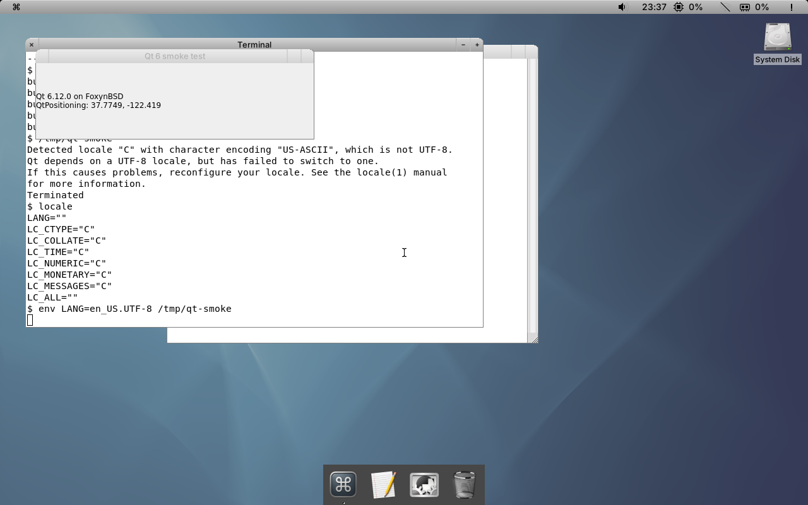

# Qt 6.12 desktop experiment

Qt is not yet part of the FoxynBSD desktop installation. This records an
experimental QEMU test for the browser investigation, not a supported
installation procedure.

On a FoxynBSD desktop guest, QtBase and QtPositioning 6.12.0 were built
with DPorts GCC 14 and installed under `/System/Library/Qt6`. The QtBase
build used experimental DragonFly adaptations of DPorts patches, static
libgcc for the missing shared half-float conversion routines, and Qt's
bundled md4c because DPorts md4c 0.6.0 has different dialect flags. The
patch and build script are not yet integrated; their provenance and
licensing review remains incomplete.

In the graphical session, compile and run the test after installing that
experimental Qt build and GCC 14:

```sh
export PKG_CONFIG_PATH=/System/Library/Qt6/lib/pkgconfig
g++14 -fPIC -no-pie -static-libgcc qt-smoke.cpp -o qt-smoke \
    $(pkgconf --cflags --libs Qt6Widgets Qt6Positioning) \
    -Wl,-rpath,/System/Library/Qt6/lib -Wl,-rpath,/usr/local/lib/gcc14
./qt-smoke
```

`qt-smoke.cpp` is in `tools/desktop/tests`. The test opens a Qt Widgets
window showing the compiled Qt version and a `QGeoCoordinate` value. It
was run from the desktop user's terminal on the existing QEMU guest. The
compiler warned about the base and GCC 14 libstdc++ versions; the session
also warned that its `C` locale was not UTF-8. In that guest, the terminal
had an empty `LANG`, while `en_US.UTF-8` was installed; its installed
`Gershwin.sh` lacked the locale fallback now present in the source tree.
Running the same application from that terminal with
`LANG=en_US.UTF-8` opened it without repeating the warning. This checks an
explicit environment variable, not the session startup fallback; the
latter has not been tested with Qt in a newly built image. A separate QEMU
snapshot boot of a desktop image with the fallback did show
`LANG=en_US.UTF-8` in the desktop user's process environment; Qt itself
was not installed in that image.
Starting from the serial console without the session's X authorization
failed. The linker warning and general application compatibility remain
to be investigated. The test does not validate a browser, network access,
or physical hardware.




